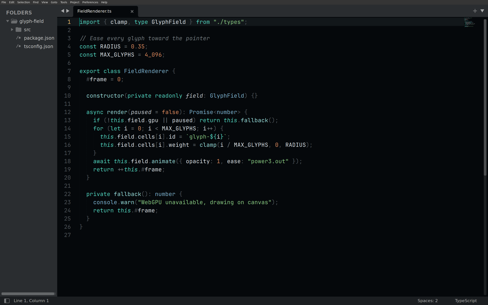
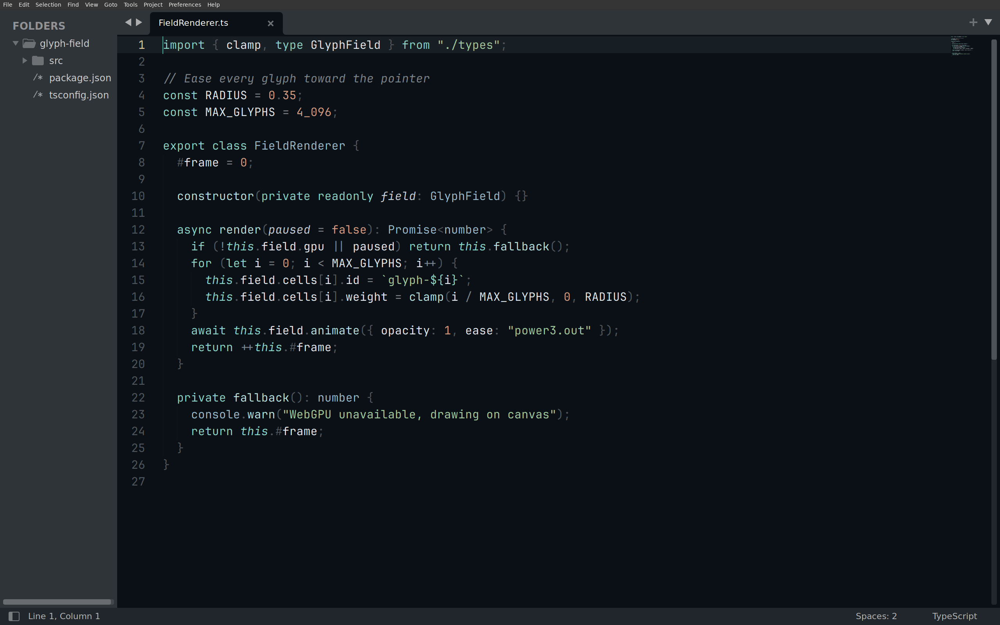
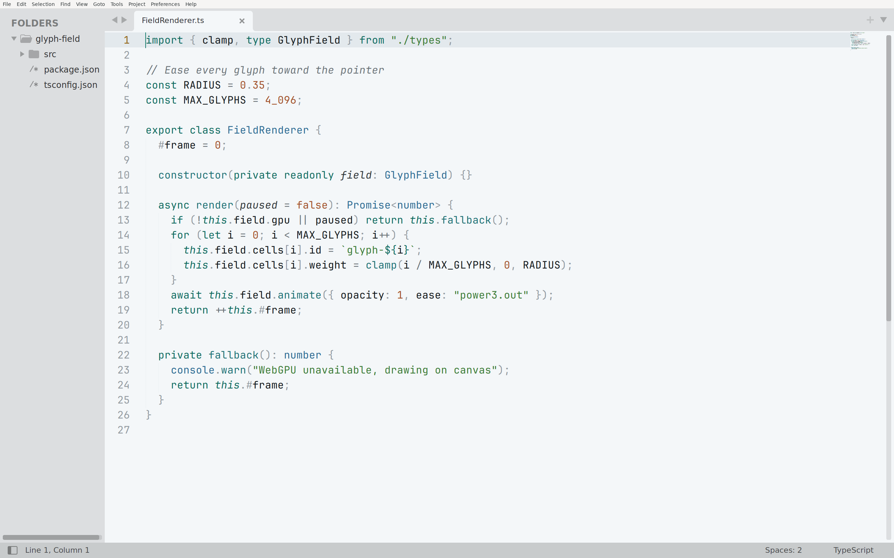
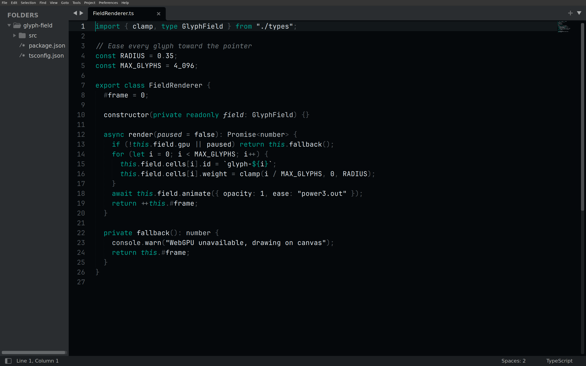

<!-- living-code-readme:1 -->
# 🌅 Living Code for Sublime Text

**Calm slate. Living color.** Living Code for Sublime Text. Repository-owned theme files, installation instructions and four color flavors.

[Installation](#installation) · [Flavors](#flavors) · [Configuration](#configuration) · [All ports](https://github.com/living-code-theme)

## Previews

<table data-lc-flavors>
<tr>
<td width="50%" valign="top">
<strong>Night</strong><br><sub>Dark · full palette</sub><br><br>
<a href="images/night.png"></a>
</td>
<td width="50%" valign="top">
<strong>Frost</strong><br><sub>Dark · softer chroma</sub><br><br>
<a href="images/frost.png"></a>
</td>
</tr>
<tr>
<td width="50%" valign="top">
<strong>Paper</strong><br><sub>Light · near-white slate</sub><br><br>
<a href="images/paper.png"></a>
</td>
<td width="50%" valign="top">
<strong>Signal</strong><br><sub>Dark · teal accent</sub><br><br>
<a href="images/signal.png"></a>
</td>
</tr>
</table>

Select any preview to view the image at full size.

## Installation

Targets Sublime Text 4. It uses the modern `.sublime-color-scheme` format, one file per flavor.

Download the four color schemes into your `Packages/User` folder (the same folder as *Preferences → Browse Packages…*), then pick *Preferences → Select Color Scheme → Living Code Night* (or *UI: Select Color Scheme*). Flavors: Night, Frost, Paper and Signal.

Linux:

```sh
curl -fsSL --create-dirs --output-dir "${XDG_CONFIG_HOME:-$HOME/.config}/sublime-text/Packages/User" -O "https://raw.githubusercontent.com/living-code-theme/sublime/main/living-code-{night,frost,paper,signal}.sublime-color-scheme"
```

macOS:

```sh
curl -fsSL --create-dirs --output-dir "$HOME/Library/Application Support/Sublime Text/Packages/User" -O "https://raw.githubusercontent.com/living-code-theme/sublime/main/living-code-{night,frost,paper,signal}.sublime-color-scheme"
```

**Package Control:** the package name remains **Living Code**. Until it is listed in the channel, use the manual downloads above.

The source files are in [the repository root](.). To customize a manual install, edit the copied file. With the Package Control install, add a `Packages/User/<Scheme>.sublime-color-scheme` with the same file name as the package scheme and override entries under `variables` or `globals`.

`pnpm run package:sublime` builds `dist/sublime/Living Code.sublime-package` from the same generator. The [bat · delta (tmTheme) port](https://github.com/living-code-theme/tmtheme) stays for bat and delta; Sublime Text should use this native scheme.

## Flavors

Expand a flavor for its full-size preview and activation instructions.

<details data-lc-flavor="night">
<summary><strong>Night</strong> · Dark · full palette</summary>

<p><a href="images/night.png"></a></p>

Pick **Living Code Night** in *Preferences → Select Color Scheme*. The scheme file is `living-code-night.sublime-color-scheme`.

</details>

<details data-lc-flavor="frost">
<summary><strong>Frost</strong> · Dark · softer chroma</summary>

<p><a href="images/frost.png"></a></p>

Pick **Living Code Frost** in *Preferences → Select Color Scheme*. The scheme file is `living-code-frost.sublime-color-scheme`.

</details>

<details data-lc-flavor="paper">
<summary><strong>Paper</strong> · Light · near-white slate</summary>

<p><a href="images/paper.png"></a></p>

Pick **Living Code Paper** in *Preferences → Select Color Scheme*. The scheme file is `living-code-paper.sublime-color-scheme`.

</details>

<details data-lc-flavor="signal">
<summary><strong>Signal</strong> · Dark · teal accent</summary>

<p><a href="images/signal.png"></a></p>

Pick **Living Code Signal** in *Preferences → Select Color Scheme*. The scheme file is `living-code-signal.sublime-color-scheme`.

</details>

## Configuration

See [Sublime Text's documentation](https://www.sublimetext.com) for application settings and reload behavior. The activation instructions above identify each supported flavor; keep your other application configuration.

## Compatibility

Targets Sublime Text 4 using the native .sublime-color-scheme format. The package remains Living Code, with v-prefixed release tags. bat and delta should use the separate tmTheme port.

## Contributing

Found a problem? [Open an issue](https://github.com/living-code-theme/sublime/issues/new/choose) with the app version, the flavor and a screenshot. Want Living Code somewhere else? [Request a port](https://github.com/living-code-theme/core/issues/new?template=port-request.yml).

Pull requests are welcome. Keep this README, `port.json` and `images/` in sync, and use real screenshots of the app, never mockups.

🦎 **One chameleon, many habitats.** Part of [Living Code](https://github.com/living-code-theme).

## License

[MIT](LICENSE) © Elliot Luque
